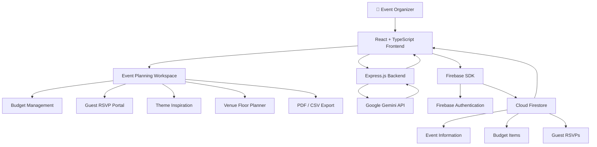

# 🌸 Atelier Blush — AI-Powered Celebration Event Planner

### Plan Beautiful Moments. Manage Every Detail. Celebrate Without Stress.

<p align="center">
  <a href="https://atelier-blush-celebration-event-planner.ai.studio">
    
  </a>
  <a href="https://github.com/shivnandan225/telier-Blush-Celebration-Event-Planner">
    
  </a>
</p>

<p align="center">
  <b>An intelligent event management platform that transforms complex celebration planning into a simple, interactive, and organized experience.</b>
</p>

---

## 📌 About The Project

**Atelier Blush** is an AI-powered celebration and event planning web application designed to simplify the process of organizing weddings, birthdays, corporate events, baby showers, and other special occasions.

Traditional event planning involves managing multiple tasks, including budgeting, guest lists, invitations, venue arrangements, seating plans, and expense tracking.

Atelier Blush brings these activities together in one centralized platform with AI-powered recommendations and real-time cloud synchronization.

Whether you are planning an intimate birthday party or a grand wedding celebration, Atelier Blush helps you organize every detail efficiently.

## 🎯 Problem Statement

Event planning can become complicated because organizers often struggle with:

- Managing expenses and staying within budget.
- Tracking guest confirmations and attendance.
- Coordinating invitations and meal preferences.
- Selecting themes according to the available budget.
- Managing seating arrangements and venue capacity.
- Keeping all event information organized in one place.

## 💡 Our Solution

Atelier Blush provides an intelligent event management workspace that combines:

- AI-based event planning assistance.
- Automated multi-currency budget management.
- Real-time guest RSVP management.
- Personalized theme recommendations.
- Interactive venue floor-plan visualization.
- Downloadable event coordination reports.

The goal is to make event planning smarter, faster, and more accessible.

---

## ✨ Key Features

### 🤖 1. AI-Powered Planning Assistant
- Interactive AI assistant available directly inside the application.
- Supports Wedding, Birthday, Corporate Gala, and Baby/Bridal Shower planning.
- Generates budget allocations and personalized planning suggestions.
- Recommends suitable event themes and cost-saving ideas.
- Powered by Google's Gemini API through a server-side integration.

### 💰 2. Smart Multi-Currency Budget Management
- Supports 9 currencies: USD, INR, EUR, GBP, AUD, CAD, AED, SGD, and JPY.
- Organizes expenses into fixed packages and per-guest costs.
- Tracks estimated budgets against actual paid deposits.
- Automatically recalculates guest-dependent expenses.
- Provides over-budget alerts and cost-saving recommendations.

### 👥 3. Real-Time Guest RSVP Management
- Cloud-based guest management using Firebase Firestore.
- Shareable public RSVP invitation links.
- Guest attendance and party-size tracking.
- Meal selection and dietary preference collection.
- Live synchronization of guest counts and meal preferences.

### 🎨 4. AI-Assisted Theme Inspiration
- Curated event themes based on budget categories.
- Visual theme inspiration and color palettes.
- Event setup photography.
- Helps organizers select an aesthetic that matches their celebration.

### 🏛️ 5. Interactive Venue Floor-Plan Simulator
- Dynamic SVG-based venue visualization.
- Multiple seating arrangements:
  - Round Banquet
  - Long Imperial
  - Cocktail Hi-Tops
  - Ceremony Rows
- Adjustable floral density and room zones.
- Includes stage, dance floor, catering bar, and photo lounge.
- Adapts to guest-count changes.

### 📄 6. PDF, Print & CSV Export
- Generate printable event coordination reports.
- Export budget and expense information.
- Download guest rosters and coordination details.
- Save event plans as PDF through the print workflow.
- CSV export for further analysis and record keeping.

---

## 🛠️ Technology Stack

| Category | Technologies |
|---|---|
| Frontend | React 19, TypeScript |
| Styling | Tailwind CSS v4 |
| Build Tool | Vite 8 |
| Backend | Node.js, Express.js |
| AI Integration | Google Gemini API, @google/genai |
| Database | Firebase Firestore |
| Authentication | Firebase Authentication |
| Icons | Lucide React |
| Deployment | Google AI Studio hosting |
| Code Quality | ESLint, TypeScript |

---

## 🏗️ System Architecture

Atelier Blush follows a client-server architecture with cloud-based authentication, real-time database synchronization, and server-side AI integration.

### Architecture Diagram



### Architecture Components

**1. Presentation Layer**
- React and TypeScript.
- Interactive event planning dashboard.
- Budget, RSVP, themes, and venue interfaces.

**2. Application Layer**
- Express.js server.
- API endpoint for AI assistant requests.
- Gemini-powered planning recommendations.

**3. Data Layer**
- Firebase Firestore for cloud data storage.
- Firebase Authentication for Google Sign-In.
- Real-time database listeners for synchronized updates.

**4. Export Layer**
- Printable PDF coordination packets.
- CSV-based event and budget reports.

### Database Structure

```text
Firestore Database
│
└── events/
    └── {eventId}/
        ├── Event Information
        │
        ├── budgetItems/
        │   └── {itemId}
        │
        └── rsvps/
            └── {rsvpId}
```

---

## 🔄 How It Works

1. **Create an Event:** Select the event category and enter the guest count, currency, and target budget.
2. **Get AI Assistance:** Receive planning recommendations, suggested budget allocations, and cost-saving tips.
3. **Manage Your Budget:** Organize expenses and monitor actual spending.
4. **Invite Guests:** Generate a shareable RSVP link and collect guest responses.
5. **Design Your Venue:** Explore seating layouts and customize the floor plan.
6. **Finalize Your Plan:** Export event information and coordination reports.

---

## ⚙️ Installation & Setup

Follow these steps to run Atelier Blush locally.

### Prerequisites

- Node.js (LTS recommended)
- npm or Bun
- Firebase project
- Google Gemini API key

### 1. Clone the Repository

```bash
git clone https://github.com/shivnandan225/telier-Blush-Celebration-Event-Planner.git

cd telier-Blush-Celebration-Event-Planner
```

### 2. Install Dependencies

```bash
npm install
```

### 3. Configure Environment Variables

Create a `.env` file in the project root and configure the variables required by the application.

Use `.env.example` as the reference for the exact variable names.

Add your Firebase configuration and Gemini API credentials as required by the project.

**Important:** Never commit API keys, private credentials, or your `.env` file to GitHub.

### 4. Run the Development Server

```bash
npm run dev
```

### 5. Build for Production

```bash
npm run build
```

---

## 🔐 Security & Reliability

- Server-side AI API integration to avoid exposing private API credentials in the browser.
- Firebase Authentication for user authentication.
- Firestore security rules for database access control.
- Environment-based configuration.
- TypeScript checks for improved code reliability.

---

## 🚀 Future Enhancements

Some potential improvements for future versions:

- 📱 Progressive Web App (PWA) support.
- 💳 Online payment gateway integration.
- 📧 Automated email and WhatsApp invitations.
- 📅 Event scheduling and calendar integration.
- 🏨 Venue and vendor booking integration.
- 📊 Advanced analytics and expense insights.
- 🌐 Multilingual AI planning assistant.
- 🎟️ QR-code-based guest check-in.

---

## 🎯 Project Highlights

| Feature | Implementation |
|---|---|
| AI Event Planning | Gemini API |
| Budget Automation | Multi-currency expense tracking |
| Guest Management | Firebase Firestore |
| Authentication | Firebase Auth |
| Venue Visualization | Interactive SVG |
| Reporting | PDF / CSV export |

---

## 🌐 Live Application

**Experience Atelier Blush:**

🔗 https://atelier-blush-celebration-event-planner.ai.studio

**Source Code:**

🔗 https://github.com/shivnandan225/telier-Blush-Celebration-Event-Planner

---

## 👨‍💻 Developer

**Shivnandan**

B.Tech Computer Science & Engineering Student

Aspiring Data Analyst | ML and Deep Learning Enthusiast

- GitHub: [@shivnandan225](https://github.com/shivnandan225)
- Project: Atelier Blush — Celebration Event Planner

---

## 🤝 Contributing

Contributions, suggestions, and feature improvements are welcome!

1. Fork this repository.
2. Create a new feature branch.
3. Commit your changes.
4. Submit a Pull Request.

---

## ⭐ Support

If you find this project interesting or useful, consider giving this repository a ⭐ on GitHub.

**Made with ❤️ to make every celebration unforgettable!**

